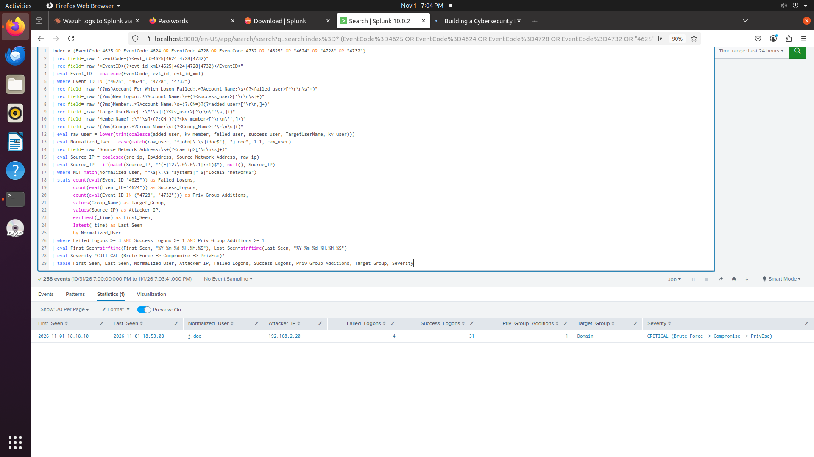

# Lab 13: Detecting a Brute Force, Successful Logon and Domain Admin Escalation in Active Directory

## Overview

One failed login on its own means very little, but a few failed logins followed by a successful one, followed by that same account being added to a privileged group, is a real attack chain. In this lab I built a Splunk detection that connects those three events and raises a single alert.

I tested it against my own lab by running the attack from `192.168.2.20` against the account `j.doe` on `DC.lab.local`, then checking whether Splunk caught the full chain.

## What I Found While Testing

My first correlation by username did not work. Windows records the account in two different formats:

* Logon events (`4624` and `4625`) store it as `j.doe`
* Group change events (`4728` and `4732`) store it as `CN=John Doe,CN=Users,DC=lab,DC=local`

Splunk saw these as two different users, so the three stages never joined. I fixed it by pulling the name out of the raw event with regex and normalizing both formats to `j.doe`. After that, everything correlated into one alert row.

In a real environment I would not hardcode that mapping. I would use an Active Directory identity lookup (a Splunk lookup table, or the `IdentityInfo` table in Sentinel).

## Lab Environment

* Domain Controller: `DC.lab.local` (`192.168.2.10`)
* Attack source: `192.168.2.20` (IT-WS01)
* Target account: `j.doe`
* SIEM: Splunk Enterprise 10.0.2

## MITRE ATT&CK Mapping

* `T1110.001` Brute Force: Password Guessing
* `T1078.002` Valid Accounts: Domain Accounts
* `T1098` Account Manipulation

## Detection Result



Splunk shows the failed logons, the successful logon from `192.168.2.20`, and the privileged group addition together in one row for `j.doe`. The events fall within about 35 minutes of each other. The success count is higher than the attack alone because `j.doe` also had normal logons in the same window, and a shorter time range gives cleaner counts.

## Detection Queries

The Splunk query is the one I ran and validated in the lab. I wrote the Sentinel and Elastic versions to show the same logic on other platforms, but I have not run them.

### Splunk (SPL)

```spl
index=* (EventCode=4625 OR EventCode=4624 OR EventCode=4728 OR EventCode=4732)
| rex field=_raw "(?ms)Account For Which Logon Failed:.*?Account Name:\s+(?<failed_user>[^\r\n\s]+)"
| rex field=_raw "(?ms)New Logon:.*?Account Name:\s+(?<success_user>[^\r\n\s]+)"
| rex field=_raw "(?ms)Member:.*?Account Name:\s+(?:CN=)?(?<added_user>[^\r\n,]+)"
| rex field=_raw "(?ms)Group:.*?Group Name:\s+(?<Group_Name>[^\r\n\s]+)"
| rex field=_raw "Source Network Address:\s+(?<raw_ip>[^\r\n\s]+)"
| eval raw_user = lower(trim(coalesce(added_user, failed_user, success_user)))
| eval Normalized_User = case(match(raw_user, "^john[\.\s]+doe$"), "j.doe", 1=1, raw_user)
| eval Source_IP = if(match(raw_ip, "^(-|127\.0\.0\.1|::1)$"), null(), raw_ip)
| where NOT match(Normalized_User, "(\$$|^(-|system|local service|network service)$)")
| stats count(eval(EventCode="4625")) as Failed_Logons,
        count(eval(EventCode="4624")) as Success_Logons,
        count(eval(EventCode="4728" OR EventCode="4732")) as Priv_Group_Additions,
        values(Group_Name) as Target_Group,
        values(Source_IP) as Attacker_IP,
        earliest(_time) as First_Seen,
        latest(_time) as Last_Seen
        by Normalized_User
| where Failed_Logons >= 3 AND Success_Logons >= 1 AND Priv_Group_Additions >= 1
| eval First_Seen=strftime(First_Seen, "%Y-%m-%d %H:%M:%S"), Last_Seen=strftime(Last_Seen, "%Y-%m-%d %H:%M:%S")
| eval Severity="CRITICAL"
| table First_Seen, Last_Seen, Normalized_User, Attacker_IP, Failed_Logons, Success_Logons, Priv_Group_Additions, Target_Group, Severity
```

### Microsoft Sentinel (KQL)

```kql
SecurityEvent
| where TimeGenerated > ago(1h)
| where EventID in (4625, 4624, 4728, 4732)
| extend RawUser = tolower(iff(EventID in (4728, 4732), MemberName, TargetUserName))
| extend ParsedCN = extract(@"^(?:cn=)?([^,]+)", 1, RawUser)
| extend Normalized_User = iff(ParsedCN matches regex @"^john[\.\s]+doe$", "j.doe", ParsedCN)
| where Normalized_User !endswith "$" and Normalized_User !in ("system", "-", "local service", "network service")
| extend Clean_IP = iff(IpAddress in ("-", "127.0.0.1", "::1", ""), "", IpAddress)
| summarize
    First_Seen = min(TimeGenerated),
    Last_Seen = max(TimeGenerated),
    Failed_Logons = countif(EventID == 4625),
    Success_Logons = countif(EventID == 4624),
    Priv_Group_Additions = countif(EventID in (4728, 4732)),
    Attacker_IP = make_set_if(Clean_IP, isnotempty(Clean_IP)),
    Target_Group = make_set_if(TargetUserName, EventID in (4728, 4732))
    by Normalized_User
| where Failed_Logons >= 3 and Success_Logons >= 1 and Priv_Group_Additions >= 1
| extend Severity = "CRITICAL"
```

### Elastic (ES|QL)

```esql
FROM logs-windows.security*
| WHERE event.code IN ("4625", "4624", "4728", "4732")
| EVAL raw_user = TO_LOWER(COALESCE(winlog.event_data.MemberName, winlog.event_data.TargetUserName, user.name))
| GROK raw_user "(?:cn=)?%{DATA:parsed_user}(?:,|$)"
| EVAL normalized_user = CASE(parsed_user RLIKE "john[.\\s]+doe", "j.doe", parsed_user)
| WHERE NOT (normalized_user LIKE "*$" OR normalized_user IN ("system", "-"))
| STATS
    first_seen = MIN(@timestamp),
    last_seen = MAX(@timestamp),
    failed_logons = COUNT(*) WHERE event.code == "4625",
    success_logons = COUNT(*) WHERE event.code == "4624",
    priv_group_additions = COUNT(*) WHERE event.code IN ("4728", "4732"),
    attacker_ip = VALUES(source.ip)
    BY normalized_user
| WHERE failed_logons >= 3 AND success_logons >= 1 AND priv_group_additions >= 1
```

## Response Actions

If this alert fires in a real environment, this is what I would do:

1. Disable `j.doe`, revoke active Kerberos tickets, and remove the account from Domain Admins.
2. Isolate `192.168.2.20` at the firewall and check for lateral movement (Event IDs `4648`, `5140`, `7045`).
3. Review who made the group change by checking `SubjectUserName` on the `4728` / `4732` event.
4. Enforce account lockout on the DC and require MFA for privileged group changes.

## Testing Date

November 2026
