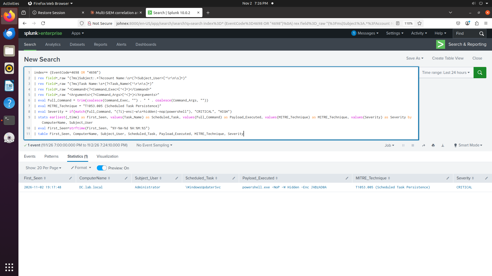

# Lab 14: Detecting AD Persistence via a Malicious Scheduled Task

## Overview

After an attacker gets admin rights, the next step is usually to make sure they can get back in even if their first access is cut off. One common way is a scheduled task that runs a hidden PowerShell command at logon. In this lab I created that kind of task on my own domain controller and built a Splunk detection to catch it.

## What I Did

I ran this on the DC to simulate the attack:

schtasks /create /tn "WindowsUpdaterSvc" /tr "powershell.exe -NoP -W Hidden -Enc JABzAD0A" /sc ONLOGON /ru SYSTEM /f

This creates a task named WindowsUpdaterSvc that runs a hidden PowerShell command every time someone logs on. The task runs as SYSTEM, but Windows still logs who created it, which in my case was the Administrator account. That is worth noting: Event ID 4698 tells you who set up the persistence, not just who it runs as.

## MITRE ATT&CK Mapping

T1053.005, Scheduled Task Persistence

## Detection Result

Splunk returned one row for DC.lab.local, showing the task name, the account that created it, the full PowerShell command, and a CRITICAL severity because the command used -Enc and -W Hidden, which are common signs of an obfuscated payload.

## Detection Query

This is the Splunk query I ran and validated against the real event.

index=* (EventCode=4698 OR "4698")
| rex field=_raw "(?ms)Subject:.*?Account Name:\s+(?<Subject_User>[^\r\n\s]+)"
| rex field=_raw "(?ms)Task Name:\s+(?<Task_Name>[^\r\n\s]+)"
| rex field=_raw "<Command>(?<Command_Exec>[^<]+)</Command>"
| rex field=_raw "<Arguments>(?<Command_Args>[^<]+)</Arguments>"
| eval Full_Command = trim(coalesce(Command_Exec, "") . " " . coalesce(Command_Args, ""))
| eval MITRE_Technique = "T1053.005 (Scheduled Task Persistence)"
| eval Severity = if(match(Full_Command, "(?i)-enc|-w\s+hidden|-nop|powershell"), "CRITICAL", "HIGH")
| stats earliest(_time) as First_Seen, values(Task_Name) as Scheduled_Task, values(Full_Command) as Payload_Executed, values(MITRE_Technique) as MITRE_Technique, values(Severity) as Severity by ComputerName, Subject_User
| eval First_Seen=strftime(First_Seen, "%Y-%m-%d %H:%M:%S")
| table First_Seen, ComputerName, Subject_User, Scheduled_Task, Payload_Executed, MITRE_Technique, Severity

I also wrote the same logic in Sentinel KQL and Elastic ES|QL below. I have not run either of them yet.

SecurityEvent
| where EventID == 4698
| parse EventData with * '<Data Name="TaskName">' Task_Name '</Data>' * '<Command>' Command_Exec '</Command>' * '<Arguments>' Command_Args '</Arguments>' *
| extend Payload_Executed = strcat(Command_Exec, " ", Command_Args)
| where Payload_Executed has_any ("-enc", "-w hidden", "-nop", "powershell")
| project TimeGenerated, Computer, SubjectUserName, Task_Name, Payload_Executed, MITRE="T1053.005", Severity="CRITICAL"

FROM logs-windows.security*
| WHERE event.code == "4698"
| WHERE message LIKE "*powershell*" OR message LIKE "*-Enc*" OR message LIKE "*-W Hidden*"
| STATS first_seen = MIN(@timestamp) BY host.name, winlog.event_data.SubjectUserName, winlog.event_data.TaskName

## Response Actions

1. Disable or delete the scheduled task and check the full command for what it was set to run.
2. Check who created it, since in my test it was the Administrator account, and confirm whether that account should have made the change.
3. Look for other persistence set up around the same time, such as new services or registry run keys.
4. Review logons from the same session for signs of how the attacker got admin rights in the first place.

## Testing Date

November 2026
