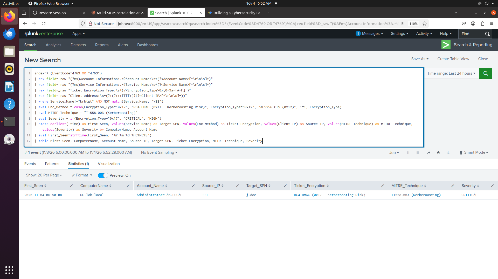

# Project 15: Detecting Kerberoasting via Kerberos TGS Ticket Requests

## Overview

After compromising an account in Project 13 and setting up persistence in Project 14, the next thing an attacker with a valid domain account often tries is Kerberoasting. Any normal domain user can ask the domain controller for a service ticket for any account that has a Service Principal Name registered, then take that ticket away and try to crack it offline to get the service account's password.

I tested this myself. First I enabled Kerberos Service Ticket Operations auditing with auditpol, since this is not logged by default. Then I registered a fake SQL service SPN on the account j.doe, and requested a ticket for it using PowerShell.

## What I Found

Event ID 4769 fires constantly on a normal domain, since every machine account checking in and every regular ticket renewal creates one. A plain search for this event code is mostly noise. To get to the real activity, I had to filter out anything tied to krbtgt and anything coming from a machine account, which always ends in a dollar sign. Once that noise was removed, Splunk showed exactly one row, the ticket request for the SQL service account, flagged because it used RC4 encryption, which is the encryption type attackers look for since it is weaker and easier to crack offline.

One thing worth pointing out plainly: the account_name field on this event shows who asked for the ticket, not who the ticket is for. In my test that was the Administrator account, since that is what I ran the PowerShell command from. The actual target, the account being roasted, was j.doe. In a real attack those two would usually be different people, a regular compromised user requesting a ticket for a service account somewhere else in the domain.

## The Query I Ran

This is the Splunk query, tested and working against the real event.

```spl
index=* (EventCode=4769 OR "4769")
| rex field=_raw "(?ms)Account Information:.*?Account Name:\s+(?<Account_Name>[^\r\n\s]+)"
| rex field=_raw "(?ms)Service Information:.*?Service Name:\s+(?<Service_Name>[^\r\n\s]+)"
| rex field=_raw "Ticket Encryption Type:\s+(?<Encryption_Type>0x[0-9a-fA-F]+)"
| rex field=_raw "Client Address:\s+(?:(?:::ffff:)?(?<Client_IP>[^\r\n\s]+))"
| where Service_Name!="krbtgt" AND NOT match(Service_Name, "\$$")
| eval Enc_Method = case(Encryption_Type="0x17", "RC4-HMAC (0x17 - Kerberoasting Risk)", Encryption_Type="0x12", "AES256-CTS (0x12)", 1=1, Encryption_Type)
| eval MITRE_Technique = "T1558.003 (Kerberoasting)"
| eval Severity = if(Encryption_Type="0x17", "CRITICAL", "HIGH")
| stats earliest(_time) as First_Seen, values(Service_Name) as Target_SPN, values(Enc_Method) as Ticket_Encryption, values(Client_IP) as Source_IP, values(MITRE_Technique) as MITRE_Technique, values(Severity) as Severity by ComputerName, Account_Name
| eval First_Seen=strftime(First_Seen, "%Y-%m-%d %H:%M:%S")
| table First_Seen, ComputerName, Account_Name, Source_IP, Target_SPN, Ticket_Encryption, MITRE_Technique, Severity
```

I also wrote the same logic for Sentinel and Elastic below, just to show I know the syntax on other platforms. I have not run either of them, since I do not have Sentinel or Elastic set up in my lab right now.

```kql
SecurityEvent
| where EventID == 4769
| parse EventData with * '<Data Name="TargetUserName">' Account_Name '</Data>' * '<Data Name="ServiceName">' Service_Name '</Data>' * '<Data Name="TicketEncryptionType">' Encryption_Type '</Data>' *
| where Service_Name != "krbtgt" and not(Service_Name endswith "$")
| where Encryption_Type in ("0x17", "0x18") or Service_Name has "MSSQLSvc"
| project TimeGenerated, Computer, Account_Name, IpAddress, Service_Name, Encryption_Type, MITRE="T1558.003", Severity="CRITICAL"
```

```esql
FROM logs-windows.security*
| WHERE event.code == "4769"
| WHERE winlog.event_data.ServiceName != "krbtgt" AND NOT winlog.event_data.ServiceName LIKE "*$"
| WHERE winlog.event_data.TicketEncryptionType == "0x17" OR winlog.event_data.ServiceName LIKE "*MSSQLSvc*"
| STATS first_seen = MIN(@timestamp) BY host.name, winlog.event_data.TargetUserName, winlog.event_data.ServiceName, winlog.event_data.TicketEncryptionType
```

## What I Would Do About It

If I saw this alert for real, here is what I would do next. Reset the password on the targeted service account with something long and random, or better, move it to a Group Managed Service Account so the password rotates on its own. Turn off RC4 on service accounts where possible and push them to AES256 instead. And look closely at whoever requested the ticket and where they requested it from, since tools like Rubeus and Impacket's GetUserSPNs.py are the usual way this gets automated.

## Evidence



## Testing Date

November 2026
