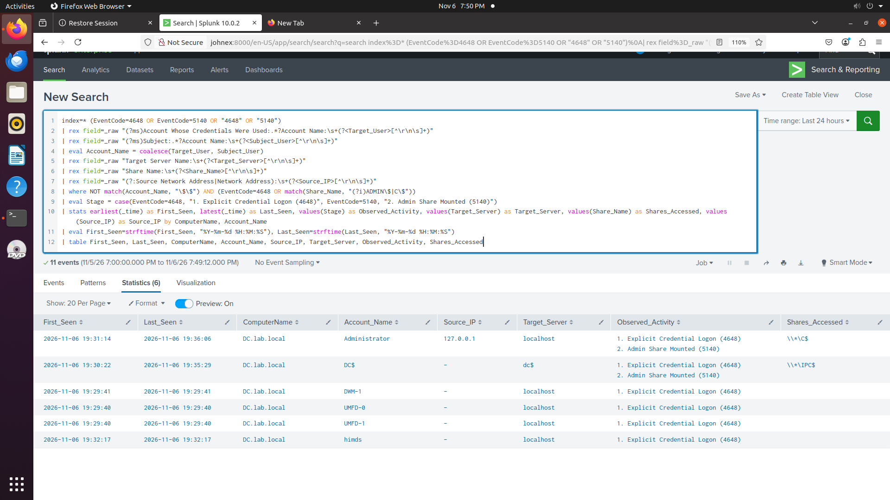

# Project 16: Detecting SMB Lateral Movement via Explicit Credentials and Admin Shares (Event ID 4648 & 5140)

## Lab Context and Objective
After testing initial access (`Project 13`), scheduled task persistence (`Project 14`), and Kerberoasting (`Project 15`), the next phase of an Active Directory intrusion is moving laterally between systems. When an attacker obtains valid credentials for an account with local administrator rights on another server, the most direct way to pivot over SMB (TCP 445) is authenticating with explicit credentials and mounting default administrative shares (`ADMIN$` or `C$`). Tools like PsExec, Impacket (`smbexec.py`, `wmiexec.py`), and native Windows `net use` rely on this exact mechanism.

The goal of this lab was to reproduce that pivot against my Domain Controller (`DC.lab.local` / `192.168.2.10`) using the compromised `j.doe` account and build a detection rule that pairs the explicit credential logon (`Event ID 4648`) with the resulting administrative share mount (`Event ID 5140`) without getting buried in normal domain file-share noise.

## Audit Policy Configuration and Testing
Out of the box, Windows Server logs `Event ID 4648` (`A logon was attempted using explicit credentials`), but it does not log network share access (`Event ID 5140`) unless Object Access auditing is configured.

Before running the test, I enabled `File Share` auditing on `DC.lab.local`:
~~~powershell
auditpol /set /subcategory:"File Share" /success:enable /failure:enable
~~~

Next, I simulated an operator authenticating explicitly as `LAB\j.doe` to mount `ADMIN$` and list the contents of `C$` on the Domain Controller:
~~~powershell
net use \\DC.lab.local\ADMIN$ /user:LAB\j.doe *
dir \\DC.lab.local\C$
net use \\DC.lab.local\ADMIN$ /delete /y
~~~

## Parsing Challenges and Tuning Decisions
While inspecting the raw events in Splunk, two practical issues stood out that had to be handled in the query logic:

1. **Dual `Account Name` Fields in Event ID 4648:**
   A raw `4648` event contains two separate `Account Name` blocks: the `Subject` (the local session running the command) and `Account Whose Credentials Were Used` (the target identity passed over the network, `j.doe`). A generic regex for `Account Name:` only grabs the first one (`Subject`), which breaks correlation when the attacker runs `net use` from a different local user session. To fix this, I wrote a specific regex to extract `Target_User` from the `Account Whose Credentials Were Used` block first, falling back to `Subject_User` via `coalesce()` for Event ID `5140`.

2. **High-Volume `SYSVOL`, `NETLOGON`, and `IPC$` Noise in Event ID 5140:**
   Once File Share auditing is enabled on a Domain Controller, `Event ID 5140` triggers constantly as domain-joined endpoints (`$`) pull Group Policy objects from `\\*\SYSVOL` and `\\*\IPC$`. Alerting on raw `5140` events is unusable in production. I restricted the query to exclude machine accounts (`NOT match(Account_Name, "\$$")`) and only match administrative shares (`ADMIN$` and `C$`).

## Multi-SIEM Detection Queries

### 1. Splunk (SPL)
~~~spl
index=* (EventCode=4648 OR EventCode=5140 OR "4648" OR "5140")
| rex field=_raw "(?ms)Account Whose Credentials Were Used:.*?Account Name:\s+(?<Target_User>[^\r\n\s]+)"
| rex field=_raw "(?ms)Subject:.*?Account Name:\s+(?<Subject_User>[^\r\n\s]+)"
| eval Account_Name = coalesce(Target_User, Subject_User)
| rex field=_raw "Target Server Name:\s+(?<Target_Server>[^\r\n\s]+)"
| rex field=_raw "Share Name:\s+(?<Share_Name>[^\r\n\s]+)"
| rex field=_raw "(?:Source Network Address|Network Address):\s+(?<Source_IP>[^\r\n\s]+)"
| where NOT match(Account_Name, "\$$") AND (EventCode=4648 OR match(Share_Name, "(?i)ADMIN\$|C\$"))
| eval Stage = case(EventCode=4648, "1. Explicit Credential Logon (4648)", EventCode=5140, "2. Admin Share Mounted (5140)")
| stats earliest(_time) as First_Seen, latest(_time) as Last_Seen, values(Stage) as Observed_Activity, values(Target_Server) as Target_Server, values(Share_Name) as Shares_Accessed, values(Source_IP) as Source_IP by ComputerName, Account_Name
| eval First_Seen=strftime(First_Seen, "%Y-%m-%d %H:%M:%S"), Last_Seen=strftime(Last_Seen, "%Y-%m-%d %H:%M:%S")
| table First_Seen, Last_Seen, ComputerName, Account_Name, Source_IP, Target_Server, Observed_Activity, Shares_Accessed
~~~

### 2. Microsoft Sentinel (KQL)
~~~kql
SecurityEvent
| where EventID in (4648, 5140)
| extend Account_Used = iff(EventID == 4648, TargetUserName, SubjectUserName)
| where not(Account_Used endswith "$")
| where EventID == 4648 or ShareName has_any ("ADMIN$", "C$")
| summarize First_Seen = min(TimeGenerated), Last_Seen = max(TimeGenerated),
            Events_Logged = make_set(EventID),
            Target_Servers = make_set(TargetServerName),
            Shares_Mounted = make_set(ShareName)
            by Computer, Account_Used, IpAddress
| where array_length(Events_Logged) > 1 or Shares_Mounted has_any ("ADMIN$", "C$")
~~~

### 3. Elastic Security (ES|QL)
~~~esql
FROM logs-windows.security*
| WHERE event.code IN ("4648", "5140")
| EVAL account_used = CASE(event.code == "4648", winlog.event_data.TargetUserName, winlog.event_data.SubjectUserName)
| WHERE NOT account_used LIKE "*$"
| WHERE event.code == "4648" OR winlog.event_data.ShareName IN ("\\\\*\\ADMIN$", "\\\\*\\C$")
| STATS first_seen = MIN(@timestamp), last_seen = MAX(@timestamp),
        events = VALUES(event.code), shares = VALUES(winlog.event_data.ShareName)
        BY host.name, account_used, source.ip
~~~

## Containment and Remediation Notes
* **Session Termination:** Enumerate active SMB sessions on the target server via `Get-SmbSession` and close unauthorized connections (`Close-SmbSession`).
* **Account & Host Isolation:** Disable the compromised account or rotate its credentials twice (if Kerberos ticket theft is suspected), and isolate the source workstation initiating the connection.
* **Hardening:** Restrict inbound SMB (TCP 445) between workstations via Windows Defender Firewall with Advanced Security, and limit Domain Admin / local administrator privileges across tier boundaries so stolen workstation credentials cannot mount `ADMIN$` on Tier-0 assets.

