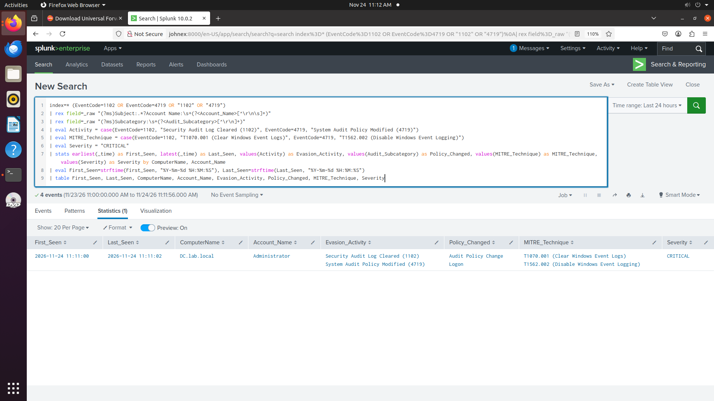

# Project 17: Detecting Defense Evasion — Audit Log Clearing and Policy Tampering (Event ID 1102 & 4719)

## Lab Context and Objective
After initial access (`Project 13`), persistence (`Project 14`), Kerberoasting (`Project 15`), and SMB lateral movement (`Project 16`), attackers often try to erase their tracks before leaving the environment. On Windows Server, the two most common ways to blind a SOC are disabling audit subcategories via `auditpol` (`Event ID 4719`) and wiping the Security Event Log with `wevtutil cl Security` (`Event ID 1102`).

In this lab, I simulated both actions on `DC.lab.local` (`192.168.2.10`) and built a high-confidence detection rule across Splunk, Microsoft Sentinel, and Elastic Security.

## Testing and Telemetry Notes
When an attacker clears the Windows Security log using `wevtutil cl Security`, the historical events on the host are wiped, but the Windows Event Log service (`Microsoft-Windows-Eventlog`) automatically writes a single new **Event ID 1102** entry containing the `Subject` account that executed the clear command. 

Before clearing the log, I also disabled and re-enabled the `Logon` audit subcategory via `auditpol` to generate **Event ID 4719** (`System audit policy was changed`). Pairing `4719` with `1102` catches both quiet log-suppression attempts and overt log wiping. Because clearing the Security log on a Domain Controller is never normal operational behavior, this detection runs with virtually zero false positives.

## Multi-SIEM Detection Queries

### 1. Splunk (SPL)
~~~spl
index=* (EventCode=1102 OR EventCode=4719 OR "1102" OR "4719")
| rex field=_raw "(?ms)Subject:.*?Account Name:\s+(?<Account_Name>[^\r\n\s]+)"
| rex field=_raw "(?ms)Subcategory:\s+(?<Audit_Subcategory>[^\r\n]+)"
| eval Activity = case(EventCode=1102, "Security Audit Log Cleared (1102)", EventCode=4719, "System Audit Policy Modified (4719)")
| eval MITRE_Technique = case(EventCode=1102, "T1070.001 (Clear Windows Event Logs)", EventCode=4719, "T1562.002 (Disable Windows Event Logging)")
| eval Severity = "CRITICAL"
| stats earliest(_time) as First_Seen, latest(_time) as Last_Seen, values(Activity) as Evasion_Activity, values(Audit_Subcategory) as Policy_Changed, values(MITRE_Technique) as MITRE_Technique, values(Severity) as Severity by ComputerName, Account_Name
| eval First_Seen=strftime(First_Seen, "%Y-%m-%d %H:%M:%S"), Last_Seen=strftime(Last_Seen, "%Y-%m-%d %H:%M:%S")
| table First_Seen, Last_Seen, ComputerName, Account_Name, Evasion_Activity, Policy_Changed, MITRE_Technique, Severity
~~~

### 2. Microsoft Sentinel (KQL)
~~~kql
SecurityEvent
| where EventID in (1102, 4719)
| extend Activity = iff(EventID == 1102, "Security Audit Log Cleared", "System Audit Policy Modified")
| extend MITRE = iff(EventID == 1102, "T1070.001", "T1562.002")
| project TimeGenerated, Computer, SubjectUserName, EventID, Activity, SubcategoryGuid, MITRE, Severity="CRITICAL"
~~~

### 3. Elastic Security (ES|QL)
~~~esql
FROM logs-windows.security*
| WHERE event.code IN ("1102", "4719")
| EVAL activity = CASE(event.code == "1102", "Security Log Cleared", "Audit Policy Changed")
| STATS first_seen = MIN(@timestamp), events = VALUES(event.code), activities = VALUES(activity) BY host.name, winlog.event_data.SubjectUserName
~~~

## Containment and Response
1. Treat any `Event ID 1102` on a Domain Controller as a P1 incident and immediately verify whether an authorized change ticket exists.
2. Pivot to the SIEM's historical index (since logs already forwarded to Splunk before `wevtutil cl` are intact) to reconstruct the activity leading up to the wipe.
3. Disable the `Subject` account, force a Kerberos TGT reset if Domain Admin credentials were used, and restore baseline audit policies via Group Policy (`gpupdate /force`).

