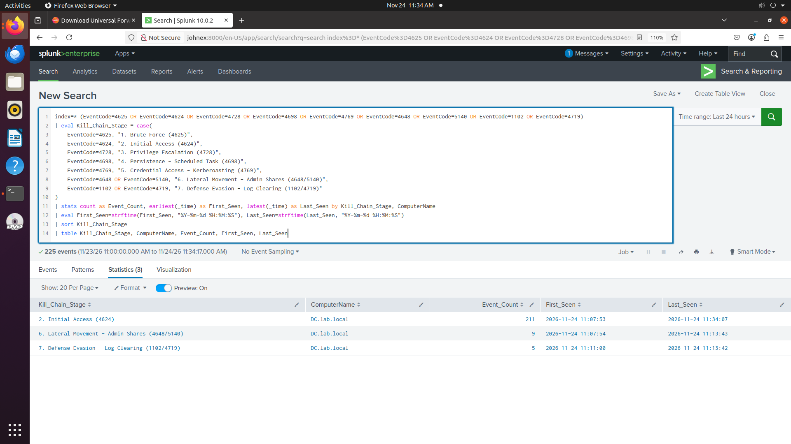

# Project 18: End-to-End Active Directory Kill-Chain Correlation and Automated Containment Playbook

## Executive Summary
Projects 13 through 17 each focused on detecting an individual stage of an Active Directory intrusion against `DC.lab.local` (`192.168.2.10`). In a real SOC, analysts need both a unified timeline that stitches those alerts together and a repeatable containment playbook to stop the breach quickly.

Project 18 closes the series by combining all five attack stages into a single master correlation query across **Splunk (SPL)**, **Microsoft Sentinel (KQL)**, and **Elastic Security (ES|QL)**, paired with an automated containment workflow (`scripts/ad_automated_containment.py` and PowerShell remediation commands).

## Full Attack Kill Chain Correlated (`INC-2026-MASTER`)
1. **Brute Force & Privilege Escalation (Project 13):** `Event ID 4625` -> `4624` -> `4728` (`MITRE T1110`, `T1098`)
2. **Persistence (Project 14):** Malicious Scheduled Task `\WindowsUpdaterSvc` running hidden PowerShell as `SYSTEM` via `Event ID 4698` (`MITRE T1053.005`)
3. **Credential Access (Project 15):** Kerberoasting SPN ticket request (`MSSQLSvc/DC.lab.local:1433`) via `Event ID 4769` (`MITRE T1558.003`)
4. **Lateral Movement (Project 16):** Explicit credential logon (`4648`) + `ADMIN$` / `C$` share mount (`5140`) (`MITRE T1021.002`)
5. **Defense Evasion (Project 17):** Audit policy tampering (`4719`) and Security log clearing (`1102`) (`MITRE T1070.001`, `T1562.002`)

## Master Multi-SIEM Kill-Chain Queries

### 1. Splunk (SPL)
~~~spl
index=* (EventCode=4625 OR EventCode=4624 OR EventCode=4728 OR EventCode=4698 OR EventCode=4769 OR EventCode=4648 OR EventCode=5140 OR EventCode=1102 OR EventCode=4719)
| eval Kill_Chain_Stage = case(
    EventCode=4625, "1. Brute Force (4625)",
    EventCode=4624, "2. Initial Access (4624)",
    EventCode=4728, "3. Privilege Escalation (4728)",
    EventCode=4698, "4. Persistence - Scheduled Task (4698)",
    EventCode=4769, "5. Credential Access - Kerberoasting (4769)",
    EventCode=4648 OR EventCode=5140, "6. Lateral Movement - Admin Shares (4648/5140)",
    EventCode=1102 OR EventCode=4719, "7. Defense Evasion - Log Clearing (1102/4719)"
)
| stats count as Event_Count, earliest(_time) as First_Seen, latest(_time) as Last_Seen by Kill_Chain_Stage, ComputerName
| eval First_Seen=strftime(First_Seen, "%Y-%m-%d %H:%M:%S"), Last_Seen=strftime(Last_Seen, "%Y-%m-%d %H:%M:%S")
| sort Kill_Chain_Stage
| table Kill_Chain_Stage, ComputerName, Event_Count, First_Seen, Last_Seen
~~~

### 2. Microsoft Sentinel (KQL)
~~~kql
SecurityEvent
| where EventID in (4625, 4624, 4728, 4698, 4769, 4648, 5140, 1102, 4719)
| extend Kill_Chain_Stage = case(
    EventID == 4625, "1. Brute Force (4625)",
    EventID == 4624, "2. Initial Access (4624)",
    EventID == 4728, "3. Privilege Escalation (4728)",
    EventID == 4698, "4. Persistence (4698)",
    EventID == 4769, "5. Kerberoasting (4769)",
    EventID in (4648, 5140), "6. Lateral Movement (4648/5140)",
    "7. Defense Evasion (1102/4719)"
)
| summarize Event_Count=count(), First_Seen=min(TimeGenerated), Last_Seen=max(TimeGenerated) by Kill_Chain_Stage, Computer
| sort by Kill_Chain_Stage asc
~~~

### 3. Elastic Security (ES|QL)
~~~esql
FROM logs-windows.security*
| WHERE event.code IN ("4625", "4624", "4728", "4698", "4769", "4648", "5140", "1102", "4719")
| STATS event_count = COUNT(*), first_seen = MIN(@timestamp), last_seen = MAX(@timestamp) BY event.code, host.name
| SORT first_seen ASC
~~~

## Automated Containment Playbook (PowerShell on DC)
~~~powershell
# 1. Disable compromised account & strip unauthorized Domain Admins membership
Disable-ADAccount -Identity "j.doe"
Remove-ADGroupMember -Identity "Domain Admins" -Members "j.doe" -Confirm:$false

# 2. Remove rogue persistence scheduled task
schtasks /delete /tn "WindowsUpdaterSvc" /f

# 3. Remove test SPN and block attacker workstation IP at host firewall
setspn -D MSSQLSvc/DC.lab.local:1433 j.doe
New-NetFirewallRule -DisplayName "SOC-Block-Attacker-192.168.2.20" -Direction Inbound -RemoteAddress 192.168.2.20 -Action Block
~~~

